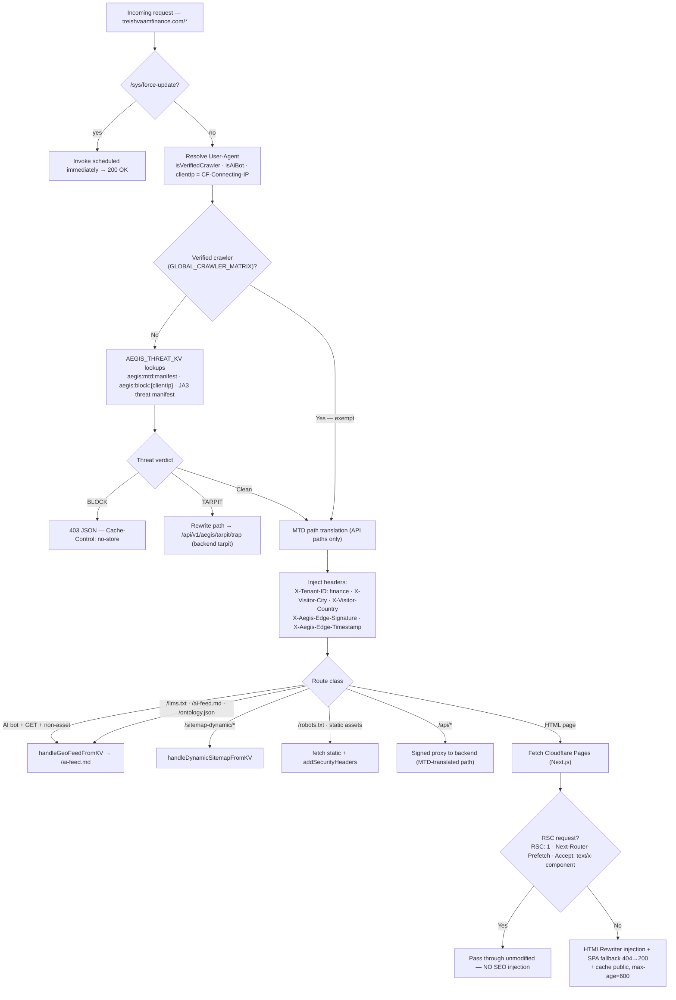
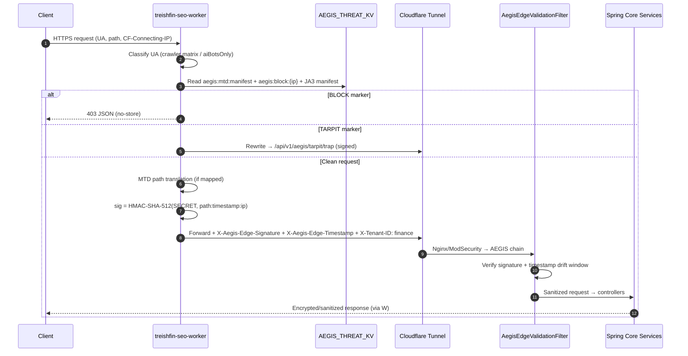

# FE-02 — Cloudflare Edge Worker Ecosystem (AEGIS Edge Layer)

**Project:** `treishvaam-finance-frontend` — Worker: `treishfin-seo-worker`
**Route:** `treishvaamfinance.com/*` (sole HTTP entry point)
**Classification:** Internal — Sanitized (no KV IDs, no signing keys)
**Verified against:** `worker/worker.js` (**721 lines** — count corrected 2026-08-23), `worker/wrangler.toml`, FIN-03 (verified 2026-05-29), Enterprise Architecture Strategy §1–2 — **and re-verified line-by-line against the actual `worker.js` on 2026-08-23**.

> [!NOTE]
> **2026-08-23 correction summary (5 errors fixed, 5 omissions added):** ① the Edge timestamp is **epoch milliseconds** (`Date.now().toString()` at every signing site — `worker.js:105,132,252,283,535,587,647,694`), not seconds; ② COOP/CORP values corrected (§11) — the worker sets `same-origin-allow-popups` and **deletes** CORP, mirroring `middleware.ts`; ③ the cron warms **all** sitemap files in batches of 10, not "the first 5"; ④ the worker performs **no JA3 evaluation** — JA3 handling lives at nginx/backend (§6); ⑤ backend threat exchange is `aegis.threat.exchange` (not "aegis.attack.telemetry"). Added: `/sys/purge-cache` (§12), the `/video-key/{videoId}` proxy (§12.1), the `api:finance:*` KV family (§8.1), the `FRONTEND_URL` var (§2), and the `public/_headers` conflict warning (§11).

---

## 1. Overview & Roles

The Worker is a single-file V8-isolate Cloudflare Worker performing six concurrent roles:

| Role | Responsibility |
| :--- | :--- |
| **Zero-Trust API Proxy** | HMAC-SHA-512 signs every backend request; injects tenant/geo headers |
| **AEGIS L4-ADA Checkpoint** | Reads KV threat manifests; blocks or tarpits malicious IPs/JA3 hashes |
| **GEO Router** | Intercepts LLM crawlers; serves KV-cached semantic payloads; bypasses React entirely |
| **SEO Intelligence Layer** | Injects JSON-LD/meta via `HTMLRewriter`; SPA-fallback prevents 404 SEO penalties |
| **Cron Cache Warmer** | Hourly proactive KV sitemap refresh via `scheduled()` |
| **Asset & Static Proxy** | Passes static assets with `Cache-Control` and security headers |

## 2. Configuration & Bindings

```toml
# worker/wrangler.toml (verified)
name = "treishfin-seo-worker"
main = "worker.js"
compatibility_date = "2024-01-01"

[[kv_namespaces]]
binding = "TREISHFIN_SEO_CACHE"   # GEO + sitemap payloads

[[kv_namespaces]]
binding = "AEGIS_THREAT_KV"       # Block/tarpit manifests + MTD route map

[triggers]
crons = ["0 * * * *"]             # Hourly sitemap warmer

[vars]
NEXT_PUBLIC_ENFORCE_STRICT_PRIVACY = "false"
```

> [!WARNING]
> **Worker Secrets — never in `wrangler.toml` or git.** Injected via `npx wrangler secret put`:
> - `AEGIS_EDGE_SECRET` — HMAC-SHA-512 seed. **Must match the backend's `AEGIS_EDGE_SECRET` byte-for-byte.** Mismatch = every proxied request rejected by `AegisEdgeValidationFilter`.
> - `BACKEND_API_URL` — Cloudflare Tunnel URL to Spring Boot backend.
> - `BACKEND_URL` — fallback alias when `BACKEND_API_URL` is absent.

> [!NOTE]
> **KV namespace IDs:** the committed `worker/wrangler.toml` legitimately contains `id` and `preview_id` for both namespaces. Cloudflare KV namespace IDs are non-secret account identifiers (standard IaC practice — required for `wrangler deploy`); this document redacts them as an extra hygiene layer only. The `[vars]` block is IaC-enforced (Phase 6.2 history): the Cloudflare dashboard locks plaintext variables when a wrangler.toml is present.

### 2.1 Cloudflare Tunnel Ingress (`worker/config.yml` — verified)

`cloudflared` tunnel config (tunnel `849d7408-…`, protocol http2):
`backend.treishvaamgroup.com` → `http://treishvaam-nginx:80`, catch-all → 404.
Authentication via the `TUNNEL_TOKEN` environment variable — no credentials file in git.
This file configures the **host-side cloudflared daemon**: ingress changes require a
cloudflared service restart on the production host, **not** `wrangler deploy`. Never delete.

## 3. Request Processing Pipeline



**RSC bypass guard (immutable):** The SEO Intelligence block is wrapped in `if (!isRscRequest)`. Applying `HTMLRewriter` to RSC binary streams caused 500 errors. Never remove this guard.

## 4. Crawler Matrix (Compiled Once Per Isolate)

Two RegExp objects compile at module load — zero per-request regex cost.

- **`GLOBAL_CRAWLER_MATRIX`** — 50+ verified bots across: search engines (Googlebot, Bingbot, DuckDuckBot, Baiduspider, YandexBot…), Google ecosystem (Googlebot-News/Image/Video, Google-Extended, AdsBot…), AI/LLMs (GPTBot, ChatGPT-User, OAI-SearchBot, ClaudeBot, anthropic-ai, PerplexityBot, DeepSeek, Bytespider, Qwen, Mistral, YouBot, Cohere-training, Diffbot…), social unfurl (Twitterbot, facebookexternalhit, LinkedInBot, Slackbot, Discordbot, TelegramBot, WhatsApp, Pinterestbot, Redditbot), news/feed readers, archivers, and the internal `Treishvaam-Worker-Crawler`.
- **`aiBotsOnly`** — the AI/LLM subset, used exclusively for GEO interception.

> [!NOTE]
> **Indexability invariant:** Bots matching `GLOBAL_CRAWLER_MATRIX` **bypass AEGIS threat evaluation entirely** to guarantee search indexability. AI bots additionally route to GEO payloads instead of React HTML.

## 5. HMAC-SHA-512 Edge Signing — `generateEdgeSignature()`

**The most critical security function in the Worker.** Every request forwarded to the backend must carry a valid AEGIS Edge Signature, enforced by the backend's `AegisEdgeValidationFilter` (AEGIS Layer 4). Unsigned direct-to-origin traffic is discarded with zero response body.

```
signature = HMAC-SHA-512(
    key  = AEGIS_EDGE_SECRET,
    data = `${pathname}:${timestamp}:${clientIp}`
)
→ hex(signature)         in X-Aegis-Edge-Signature header
→ unix epoch (ms)        in X-Aegis-Edge-Timestamp header   // Date.now().toString() — MILLISECONDS
```

> [!WARNING]
> **Timestamp unit (verified 2026-08-23, closes old Open Item #2):** the worker sends `Date.now().toString()` — **epoch milliseconds** — at every one of its 8 signing sites, and the backend `AegisEdgeValidationFilter` parses with `Long.parseLong()` and compares against `Instant.now().toEpochMilli()` with a `300 × 1000 ms` drift window. Both sides are synchronized in milliseconds; earlier editions of this doc said "(s)" here — that was a documentation typo, **not** a code defect. Senders that emit seconds (or the wrong header name `X-Aegis-Timestamp`, as the app-route proxies currently do — backend OP-18) will be rejected with `403 Malformed Timestamp` / `Payload Expired`.

**Centralized helper — do not inline (immutable rule):** `generateEdgeSignature(path, timestamp, ip, secret)` is a shared function invoked by:

1. Main `fetch()` handler (every forwarded request)
2. `scheduled()` cron handler
3. `handleGeoFeedFromKV()` on KV cache miss
4. `handleDynamicSitemapFromKV()` on KV cache miss
5. SEO intelligence hydration fetches (`/category/`, `/market/` SSR data)

Historical incident: before centralization, the cron and cache-miss paths signed stale/incorrect paths, causing 403 rejections at `AegisEdgeValidationFilter`. Re-inlining or duplicating this logic reintroduces that failure mode.

**WebCrypto note:** the Edge uses WebCrypto HMAC-SHA-512 (SHA-512 is natively supported; SHA3-512 is not). The backend filter (BouncyCastle) accepts HMAC-SHA-512 — a documented, accepted asymmetry.

> [!NOTE]
> **Contract reconciliation — RESOLVED 2026-08-23:** the Strategy document's `RequestTimestamp + Method + Path + BodyHash` / `X-AEGIS-Signature` / ±30 s description was **planning-stage fiction**. The deployed pair (verified in both codebases) is: worker signs `${pathname}:${timestamp}:${clientIp}` → headers `X-Aegis-Edge-Signature`/`X-Aegis-Edge-Timestamp` (ms) → backend validates HMAC-SHA-512 with a ±300 000 ms window, 403 on failure. Worker and filter are a matched pair; **any change to signing inputs must be synchronized across `worker.js`, `BE-02`, and `CROSS-SYSTEM-CONTEXT.md` in the same release.**

## 6. JA3 Fingerprinting & AEGIS Threat Evaluation

The Worker is the client-side enforcement point of AEGIS **L4-ADA** (Layer 3 of the 9-layer framework) and **MTD** (Layer 9):

1. **MTD manifest** — reads `aegis:mtd:manifest` from `AEGIS_THREAT_KV` (the time-sliced route translation map synchronized from backend Redis via `CloudflareEdgeSyncService`). If the incoming API path matches a manifest entry, it is translated before signing/forwarding.
2. **IP blocklist** — reads `aegis:block:{clientIp}`:
   - `BLOCK` marker → instant 403 JSON, `Cache-Control: no-store`.
   - `TARPIT` marker → path rewritten to `/api/v1/aegis/tarpit/trap` (⚠ **no backend handler exists for that path** — backend OP-05; requests 401/404).
3. **JA3 TLS fingerprint hashes — CORRECTED 2026-08-23:** the worker performs **no JA3 evaluation** (zero `ja3` references in `worker.js`). Its only threat-KV reads are the MTD manifest and `aegis:block:{clientIp}` (`worker.js:196-202`). JA3 enters the picture at the **origin**: nginx computes/forwards `X-JA3-Fingerprint` (from Cloudflare's `cf-client-ja3` or a pseudo-hash `md5(ua|tls|cipher)`), the backend's behavioral engine scores it, and the backend's `CloudflareEdgeSyncService` can push `aegis:block:ja3:{ja3}` keys into KV — which the **backend-side pipeline and future worker logic** consume; today's worker does not read them.
4. **Verified crawler exemption** — matrix-matched UAs skip threat evaluation (§4).

**Backend sync path (corrected 2026-08-23):** AEGIS filters publish attack telemetry via `RabbitMQAttackPublisher` to RabbitMQ exchange **`aegis.threat.exchange`** (routing key `threat.detected`) → `AegisThreatConsumer` → `CloudflareEdgeSyncService` (24 h in-memory dedup) writes KV `aegis:block:{ip}` / `aegis:block:ja3:{ja3}` TTL 86 400 s. (The exchange name `aegis.attack.telemetry` in earlier editions was wrong.)

## 7. Signed Request Lifecycle (End-to-End)



## 8. GEO Handler — `handleGeoFeedFromKV()`

Three-tier delivery cache for LLM-facing payloads:

| Tier | Store / Key | TTL / Cache-Control |
| :--- | :--- | :--- |
| 1. CDN Edge Cache | `caches.default` | fastest — 0 ms KV read on hit |
| 2. KV | `geo:finance:/llms.txt` · `geo:finance:/ai-feed.md` · `geo:finance:/ontology.json` | written on backend hit, `expirationTtl: 86400`; served with `public, s-maxage=86400, max-age=3600` |
| 3. Backend fallback | `BACKEND_API_URL` + `/api/public/geo{path}` | miss/error → `503 GEO Feed Unavailable` |

AI-bot responses carry **`X-GEO-Bot-Detected: true`**. Aggressive interception: AI bots requesting any HTML GET are redirected to `/ai-feed.md` (skipping React entirely).

### 8.1 `api:finance:*` SSR Cache Family (added 2026-08-23 — previously undocumented)

| KV key | TTL | Content |
| :--- | :--- | :--- |
| `api:finance:post:{id}` | 86 400 s | `/api/v1/posts/url/{id}` response → injected as `window.__PRELOADED_STATE__` on article SSR (`worker.js:523,547`) |
| `api:finance:market:{ticker}` | 3 600 s | `/market/widget` data → preloaded widget state on market pages (`worker.js:575,600`) |

Together with the GEO/sitemap keys these form the "Phase 7 High Availability" cache layer: CDN → KV → backend, with async (non-blocking) KV writes.

## 9. Dynamic Sitemap Pipeline

- KV meta key: `sitemap:finance:meta` → `{"markets":["/sitemap-dynamic/market/0.xml"],"blogs":["/sitemap-dynamic/blog/0.xml"]}` (TTL 90000).
- Per-sitemap keys: `sitemap:finance:/sitemap-dynamic/{blog|market}/N.xml` (TTL 90000).
- Path translation on backend fetch: `/sitemap-dynamic/X` → `/api/public/sitemap/X`.

**Cron (`scheduled()`, hourly — corrected 2026-08-23):** fetch `/api/public/sitemap/meta` (signed, UA `Treishvaam-Worker-Crawler/1.0`) → write meta to KV → iterate **all** sitemap files listed in the meta, **in batches of 10** (`BATCH_SIZE = 10`, `worker.js:126-128`): translate path, **generate a fresh signature for the translated path**, fetch XML, write to KV. Client IP for cron signatures is `127.0.0.1` (loopback). *(The "first 5 sitemaps" claim in earlier editions was wrong — the loop covers every chunk.)*

## 10. SEO Intelligence Injection (HTMLRewriter)

All injections guarded by `!isRscRequest`:

| Route | Injection |
| :--- | :--- |
| `/`, `/home` | WebSite JSON-LD schema + GEO discovery links (`/llms.txt`, `/ontology.json`) |
| `/about`, `/vision` | Static title/description meta + GEO links |
| `/category/{cat}/{slug}/{id}` | Backend post fetch → inject `<title>`, `meta[description]`, `window.__PRELOADED_STATE__`, GEO links |
| `/market/{ticker}` | Backend market fetch → ticker title + `window.__PRELOADED_STATE__`, GEO links |

`window.__PRELOADED_STATE__` is serialized via `safeStringify()` (escapes `<`, `>`, `&`) — XSS hardening for JSON-in-HTML injection. Full SEO strategy: FE-06.

## 11. Security Headers — `addSecurityHeaders()`

Applied to all proxied HTML/API responses:

```
Strict-Transport-Security: max-age=63072000; includeSubDomains; preload
X-Content-Type-Options: nosniff
X-XSS-Protection: 1; mode=block
Referrer-Policy: strict-origin-when-cross-origin
Permissions-Policy: geolocation=(), microphone=(), camera=(), payment=()
Cross-Origin-Opener-Policy: same-origin-allow-popups      // CORRECTED 2026-08-23 (worker.js:320)
Cross-Origin-Resource-Policy:  ← DELETED (not set)         // CORRECTED 2026-08-23 (worker.js:321)
X-Permitted-Cross-Domain-Policies: none
```

*(Earlier editions claimed `same-origin` COOP + `same-site` CORP here, and a "documented COOP asymmetry" against `middleware.ts` — both wrong: the worker was later edited — see its own immutable history, "Relaxed COOP/CORP headers in addSecurityHeaders to mirror middleware.ts" — so the worker now matches the Next.js layer: `same-origin-allow-popups`, CORP deleted. The asymmetry no longer exists; FE-04 §8's matrix is corrected accordingly.)*

Also: `Content-Security-Policy-Report-Only` is deleted; `X-Robots-Tag: noindex, noarchive` on all `/api` responses; SPA fallback overrides 404→200 with `X-SPA-Fallback: Active`; HTML cached `public, max-age=600`; on origin 5xx the CDN cache is served if available; `/api/uploads`/images get immutable 1-year CDN caching (`worker.js:392-407`).

> [!WARNING]
> **`public/_headers` conflict (added 2026-08-23):** the repo still ships `public/_headers` with `Cross-Origin-Opener-Policy: same-origin`, `Cross-Origin-Resource-Policy: same-site`, and HSTS `max-age=31536000` — contradicting both `middleware.ts:86-88` and `next.config.mjs:53-55`. The next.config history says CSP was "migrated from static `public/_headers`", but the file was never deleted. If Cloudflare Pages applies `_headers` to static assets, those assets carry the stale values — delete or update the file (no FE doc previously mentioned it).

## 12. Operations

- **Manual cache refresh (production emergency):** `GET https://treishvaamfinance.com/sys/force-update` — invokes `scheduled()` immediately.
- **Full SEO-cache purge (added 2026-08-23 — previously undocumented):** `GET https://treishvaamfinance.com/sys/purge-cache` (`worker.js:168-178`) — lists and deletes **every** `TREISHFIN_SEO_CACHE` key. The MTD manifest is **not** affected (it lives in `AEGIS_THREAT_KV`). After a purge, re-warm with `/sys/force-update` + one hit on `/llms.txt`, `/ai-feed.md`, `/ontology.json`.
- **Deployment rule (immutable):** run `npx wrangler deploy` from `worker/` **only** when `worker.js` or `worker/wrangler.toml` changed — and **before** pushing frontend changes that depend on it. Never deploy the Worker for pure frontend changes.

### 12.1 Video-Key Proxy (added 2026-08-23 — previously undocumented)

`GET /video-key/{videoId}` (`worker.js:271-306`) fronts the backend's `GET /api/v1/video/internal/key/{videoId}` for HLS AES-128 DRM key delivery: **Referer allowlist** (`treishvaamfinance.com`, `treishvaamagro.com`, `localhost`), edge-signed upstream fetch, `Content-Type: application/octet-stream`, `Cache-Control: public, max-age=300`. This proxy is the mitigation for backend OP-14 (the backend endpoint itself returns a fresh random key per call — per-video key store unimplemented).

Also note: the worker resolves the site origin from **`env.FRONTEND_URL`** (default `https://treishvaamfinance.com`, `worker.js:235`) — a fourth environment input beyond the three secrets listed in §2.

## 13. Known Gaps

- **Agro Worker parity:** `treishvaamagro-seo-worker` has **not** received the AEGIS Phase 6 upgrades (centralized signing helper, crawler matrix, GEO interception, MTD translation, `AEGIS_THREAT_KV` integration). The Finance `worker.js` logic must be mirrored into the Agro worker (substituting `BACKEND_ORIGIN`/`CF_PAGES_ORIGIN` secrets) when that frontend finalizes.

## 14. Open Items — Status after 2026-08-23 verification

| # | Item | Status |
| :--- | :--- | :--- |
| 1 | ~~Exact JA3 KV key format and hash acquisition in the Worker~~ | **Resolved:** the worker does no JA3 work at all (§6.3) — JA3 originates at nginx; `aegis:block:ja3:{ja3}` keys are backend-written and not read by the current worker |
| 2 | ~~Reconciliation of HMAC input composition Worker ↔ backend~~ | **Resolved:** 3-part `path:ts:ip`, epoch ms, ±300 s — verified both codebases (§5) |
| 3 | ~~Whether `X-Request-ID` is emitted by the Worker~~ | **Resolved:** the worker does not emit it; the backend's `RequestIdFilter` generates the ID server-side (backend BE-01 §5), and the frontend never sets it |
| 4 | **NEW** — app-route proxies (`app/llms.txt` etc.) sign 2-part with header `X-Aegis-Timestamp` → guaranteed 403 against the backend filter (backend OP-18; KV-first fallback currently masks it) | Open |
| 5 | **NEW** — `public/_headers` ships stale COOP/CORP/HSTS values contradicting middleware + next.config (§11) | Open |
